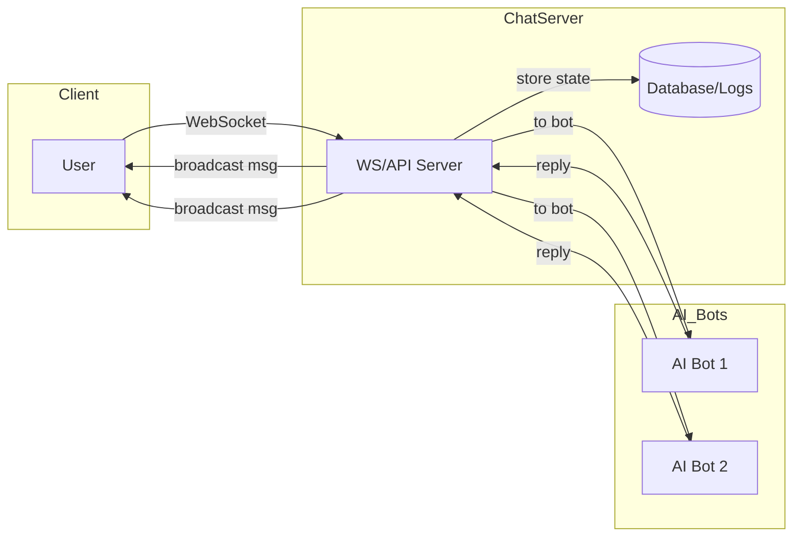

# Designing TinyTable Chatroom for AI Companions

**Recorded:** 2026-09-30
**Status:** Research synthesis provided for project records; claims and references remain to be verified before implementation or external publication.

## Executive Summary

We surveyed multi-agent chat and companion-AI literature and systems to recommend a TinyTable “room” design that balances open conversation with fairness, safety, and scalability. Architecturally, we consider classic centralized chat servers (WebSocket or XMPP-based) versus federated or peer-to-peer (P2P) models. We emphasize flexibility: e.g. a brokered model where a server routes messages, or federated protocols (like Matrix/XMPP) to allow cross-server rooms. We outline multi-agent conversation schemes (round-robin vs AI-moderated turns) informed by frameworks like Microsoft’s AutoGen. Identity is based on unique nicknames per user and per companion (like XMPP’s `<room@service/nick>` system); users may spawn multiple “bot personas” with their own labels. On the UX side, we propose standard channel/thread features (a la IRC/XMPP threads), directed messages (@mentions), and role labels/voice privileges for moderating “who can talk”. Moderation will combine automated filters (e.g. OpenAI moderation APIs), rate limits, and human oversight (flagging and auditing). For privacy/security, we support end-to-end encryption (as in Matrix’s Megolm for groups), access controls on rooms (membership lists, voice permissions), configurable data retention (ephemeral vs logged chat), and consent (notifying users when they chat with AI as required by e.g. NY law). Governance features like turn-taking tokens, chat ‘floor’ indicators, or AI-led turn selection can prevent domination. We will measure success via engagement and equity metrics (e.g. message distribution fairness, Gini coefficient), user surveys on agency, and safety incident rates. We compare ≥6 architectures and recommend starting with a simple server-based design plus “multiple agent” support via a broker (e.g. use of websockets or XMPP MUC). The phased roadmap proposes an MVP chat server with bot integrations, then progressive features (multi-agent orchestration, moderation, E2E encryption, UI cues), with resources estimated relative to existing frameworks.

## Technical Architecture

TinyTable rooms can use a **client-server model** (a central server or cluster routing messages) or a **P2P/federated** approach. A typical choice is a WebSocket-based chat server or an XMPP/MUC server. For example, XMPP’s MUC protocol treats each room as a “room@service” with occupants as “room@service/nick”. Such servers handle presence notifications, message broadcasting, and can natively support features like persistence (logging) or moderation rules. In practice a modern web-stack (e.g. React frontend, WebSocket API, backend in Node/Python/Java) works well. For scalability, microservices or cloud chat services can be used, or multi-server federation (as in Matrix) to distribute load. Matrix, for instance, supports federated rooms and end-to-end encryption, whereas XMPP requires optional extensions. Message formats are typically JSON over WebSocket or XMPP’s XML stanzas. Chat persistence is handled by a database (SQL/NoSQL) storing transcript logs and optionally knowledge bases. Latency is minimized by pushing messages via WebSocket/pubsub; round-trip should be ~100–200ms typical. High concurrency is addressed via horizontal scaling or load-balancing (e.g. XMPP servers cluster or serverless push). The Epitome research platform used a browser/client-server (React frontend, Spring Boot backend) with dynamic LLM inference and load balancing. Key trade-offs include: centralized servers simplify state and history but become bottlenecks at massive scale; pure P2P avoids servers but complicates trust and message ordering. Federated servers (Matrix/XMPP) offer decentralization and interoperability at higher complexity.

### Example architecture

## Multi-Agent Interaction Models

We support multiple AI companions (“agents”) per room and human(s). Key models:

- **Brokered (Server-Centric):** All messages route through a central server which also hosts or proxies AI bots. E.g. TinyTable server with integrated “bot proxies” (like Slack/Discord bots). The server can implement turn-taking (round-robin, AI moderator selects next speaker) or inject prompts to each agent. Microsoft’s AutoGen framework, for instance, orchestrates multi-agent group chats with either round-robin or LLM-driven speaker selection. Bots might join as “virtual users” in the room.
- **Peer-to-Peer:** Clients (human and AI bots) connect directly (e.g. via WebRTC mesh). This removes a central broker, but is complex: one must handle NAT traversal, message ordering, and ensure all parties see consistent chat state. Coordination of turn-taking is harder without a controller.
- **Federated:** Based on protocols like Matrix or federated XMPP, rooms span multiple servers. Each server uses the same protocol, replicating room messages across a network. This allows cross-organization rooms. It complicates moderation/persistence but offers scalability and decentralization. For example, Matrix uses its “Megolm” algorithm for encrypting group chats, exchanging symmetric keys securely among all peers.
- **Hybrid (Semi-distributed):** E.g. one central “coordinator” but clients also exchange some messages P2P (e.g. voice states). Or use a message queue/broker (e.g. Kafka) for server cluster communication.

For ease, a brokered server model is simplest to develop. It fully controls context, easily logs data, and can integrate multiple bots. Federated or P2P might be future enhancements if TinyTable grows beyond a single instance.

## Identity and Presence

TinyTable rooms have named participants (humans and bots). We adopt IRC/XMPP conventions: each occupant has a *room nickname* (e.g. `#room@tinytable/nick`). Users may define multiple AI companions (each with their own nick/avatar), and they can link them in UI (e.g. “Assistant Bots for Alice”). The system internally maps human accounts to companion instances. Presence notifications (join/leave/status) mirror existing chat systems: when bots or users enter the room, all see their entry.

Roles and permissions use XMPP-like “affiliations”:

- **Owner/Admin/Moderator:** Can configure room (e.g. change name), set topics, ban/kick users, and grant/revoke “voice” (speak) rights.
- **Voiced/Non-voiced:** In a *moderated* room, only those with “voice” (or moderators) may send messages. This lets admins enforce turn-taking: e.g. give the current speaker the “voice token” and strip it after they send, passing to next.
- **Bots as Users:** AI companions appear like other nicks and follow the same rules. We might label them visually (e.g. a bot badge or colored nick) so humans know they are talking with an AI persona.

Linking humans to companions is not fixed in protocol but enforced in application logic. We ensure each companion is associated to a human owner account for permissioning and accountability (e.g. only the owner or admins can delete that bot).

## UX and Conversation Affordances

To make group chat easy and fair, we recommend standard chat UI patterns:

- **Channels/Rooms:** Named chat channels (as IRC/MUC has) for topics. Users can join/leave freely (if open/public), or by invite if private.
- **Threading:** For deep discussions, allow replies to a specific message (threaded chat) so sub-conversations stay organized. This avoids sprawling linear logs.
- **Directed Messages:** Support @-mentions or direct “whispers” to a specific participant (human or bot). This helps the user direct a question to a particular AI, and helps manage focus in busy rooms.
- **Visibility Controls:** Allow users/bots to have **public** vs **private** posts. For example, a user might privately send a message to their companion that only they see (like whisper to own bot).
- **Role Labels/Cues:** Clearly show if someone is a bot (AI icon), a moderator (mod badge), or has the floor. If turn-taking is enforced, a UI cue (colored border, highlight) indicates “now speaking”. A speaking token icon or queue list can show speaking order.
- **Moderated Rooms:** As XMPP supports, allow creation of “moderated” rooms where only speakers can talk (others must wait for voice). Bots can also abide by these rules, and a bot could even serve as a “sergeant” to enforce turn-taking.
- **Sentiment/Welcoming Cues:** Optionally annotate messages with sentiment, topic highlights, or show when a bot is thinking/responding (to manage user expectations).
- **User Profiles:** Let users see a list of participants with nicknames, roles, and possibly user-set status. Bots might have fixed profile pictures or avatars.

In essence, borrow UX patterns from Slack/Discord/IRC: channels, mentions, threads, roles, and adapt to indicate AI. The XMPP MUC spec provides many analogies (persistent subjects, moderated/unmoderated, membership lists).

## Moderation & Safety

**Automated Filters:** Integrate content moderation models. For example, use an API like OpenAI’s Moderation endpoint to score all incoming messages (from humans or bots). Actions on flagged content might include redacting, warning the sender, or temporarily muting them. We can also implement rate limits per user/bot to throttle floods.

**Abuse Detection:** Monitor behavioral signals – e.g. rapid repeat messages, profanity filters, or unusual spikes – and trigger human review. Maintain **audit logs** of chats for later analysis. Research emphasizes the need for full traceability in human-AI experiments; similarly, we log all messages and meta-actions (joins, kicks, filters) for compliance and safety auditing.

**Human-in-the-Loop:** We recommend a human moderator or oversight interface. Moderators can join rooms as special users (e.g. “Alice_mod”) who can mute/kick. We might notify moderators if certain triggers happen (self-harm language, harassment reports).

**Intervention Protocols:** For serious issues (e.g. self-harm content in companions), implement safety protocols. For instance, New York’s AI companion law mandates detecting suicide/self-harm cues and interrupting the user with help resources. TinyTable should at minimum notify and allow a moderator to intervene.

**Rate Limits and Abuse:** Bots themselves should be rate-limited (to avoid spamming). Humans sending malicious prompts to bots should be limited. All generated content should be checked to avoid illegal or unsafe advice (especially if providing code or health info).

## Privacy & Security

- **Encryption:** Ideally enable end-to-end encryption (E2EE) for room messages. Federated protocols like Matrix use the Megolm scheme for group chat E2EE. In a simple TinyTable, we could use TLS transport. For maximum privacy, an optional E2EE mode would encrypt messages in clients. (Note: XMPP’s MUC doesn’t natively do E2EE, so a custom layer or Matrix-based system could be used if stringent privacy is needed.)
- **Access Controls:** Rooms can be public or private (invite-only). Use membership lists and ban-lists (XMPP MUC features) to control access. Privileges (voice, moderator) restrict who can post or manage the room. For example, we cite XEP-0045's support for grants/voicing and banning.
- **Data Retention:** Allow configuration of how long chat logs are kept. Some rooms may auto-delete (ephemeral chats), others persistent for study or legal compliance. Users should have options to delete their chat history or companion logs if privacy laws require it.
- **Consent for AI Training:** Messages should be treated carefully; if TinyTable plans to use conversation logs to fine-tune AI, users should consent. We should disclose when a user’s data might be used. (Epitome’s ethical framework includes informed consent for participants.) Also, per new policies, repeatedly remind users they’re talking to AI (as required by law).
- **Authentication:** Tie each human’s chats to a user account. Use secure login (OAuth, tokens). For bots, only authorized service-accounts or owner accounts can create/modify them.

## Governance & Equal Participation

A core goal is **equal-participation**. Some strategies:

- **Turn-taking Mechanisms:** Enforce one-speaker-at-a-time. This can be implemented by “speaking tokens”: grant one user/bot permission to speak (e.g. unlocking voice in a moderated room). After they finish, pass it to the next person. This prevents interrupting.
- **Token Queues/UI Cues:** Show a speaker queue UI or highlight who has the floor. This can visually remind dominant speakers to let others speak. Small group etiquette cues (like virtual “raise hand” to request token) can be added.
- **Reputation & Trust:** Over time, we can track participation equity metrics (how often each speaks). If some users are far quieter, the system could nudge them (“Would you like to say something?”) or limit very dominant participants automatically (rate-limit).
- **AI Role:** One companion might serve as facilitator/moderator (like a chatbot moderator). The “Bot in the Bunch” study found that a chatbot that prompts participation or summarizes can improve fairness of discussion. A similar TinyTable bot could politely invite quieter users or summarize key points, ensuring all voices matter.
- **Accessibility Options:** Ensure the UI is clear for all (e.g. colorblind-friendly labels, keyboard nav).
- **Anon vs Known:** If necessary, allow anonymous mode to reduce social inhibition (though this may hurt trust). But at least allow avatars rather than real names for those who desire privacy; anonymity may sometimes increase equal participation.

By combining system-enforced turn-taking with UX cues (highlighting speaking turns, visible participation stats), TinyTable can foster balanced dialogue.

## Evaluation Metrics & Experiments

To validate design, measure **quantitative** and **qualitative** outcomes:

- **Engagement Metrics:** e.g. number of messages per user, total session time, retention rates. These gauge overall usage and appeal.
- **Fairness/Equity Metrics:** Compute distribution of message counts or speaking turns. A Gini coefficient of message count close to 0 indicates equal sharing. Track how often each participant (including bots) gets a turn. After changes (e.g. adding turn tokens), see if equity improves.
- **Perceived Agency:** Survey users on how much control/attention they felt they had. (Use Likert-scale questions after sessions.)
- **Understanding & Satisfaction:** Did users feel the conversation was coherent and fair? Ask if any participant (AI or human) dominated inappropriately.
- **Safety Incidents:** Number of flagged messages (harassment, self-harm triggers), moderator interventions, and user reports of bad behavior. Lower is better. Compare different moderation settings.
- **Bot Evaluation:** Assess AI companions on measures like helpfulness, safety, consistency. Possibly A/B test “single AI” vs “multi-agent” rooms on user outcome.

Prior work on AI-mediated group discussions (e.g. “Bot in the Bunch”) indicates tracking user responses to bot interventions (did discussion productivity or participation change). TinyTable trials could similarly compare discussion quality with/without an active facilitator bot. All experiments should ensure user consent and anonymize personal data (ethical compliance as in Epitome’s framework).

## Implementation Examples and Case Studies

- **XMPP MUC (Jabber):** A mature chat protocol with channel semantics and privacy features. For instance, ejabberd or Prosody servers can host multi-user rooms with roles and optional message archiving. However, out-of-box XMPP lacks modern chatbot integration, so custom connectors would be needed.
- **Matrix:** An open federated chat standard. Several clients (Element, etc.) support group chats with E2E encryption and bot accounts (via Matrix APIs). Matrix’s *Megolm* algorithm secures group chats. Federated design allows bridging between servers.
- **Slack/Discord Bots:** While proprietary, Slack channels and Discord servers demonstrate multi-user chat with bots. Bots connect via APIs (Slack Events, Discord Intents). They illustrate easy mention/direct reply handling and private threads. The code architecture is brokered (Slack’s cloud acts as server).
- **Academic Research Platforms:** The *Epitome* platform and similar projects provide configurable “chatroom” modules where LLM agents and humans interact under experimental control. They implement logging and agent orchestration. Epitome’s multi-agent chatroom (and the “My Chatroom” module) shows an experimental case of human+AI chat with logs.
- **Generative Agents (Park et al. 2023):** Although focused on simulated agents, this UIST paper showed autonomous agent chat. Its group chat examples can inspire conversation flows.
- **OpenAI & Microsoft Multi-Agent Tools:** Microsoft’s AutoGen (used by GitHub Copilot Labs) allows developers to define multi-agent conversations programmatically. Its use in coding teams (Architect, Developer, Tester, etc.) shows how to label agents and sequence turns. AutoGen and NVIDIA’s NIM also explore multi-agent orchestration in code and research contexts.

## Architecture Options Comparison

| Architecture Option | Security | Scalability | Latency | Complexity | Multi-AI Support |
|---|---|---|---|---|---|
| Centralized Server (monolith) | Moderate (TLS, server controls access). E2E possible with effort. | Moderate (vertical scaling, sharding). Single point of failure. | Low latency (direct push). | Low (easy to build/deploy). | Easy: server arbitrates all AI agents. |
| Microservices/Broker (pubsub) | Good (services isolated). Add encryption at service level. | High (elastic scaling of components). | Low (efficient pub/sub). | Moderate (coordination needed). | Good: can spin multiple AI services. |
| Federated Servers (Matrix-like) | High (built-in E2EE for rooms). | Very high (no central bottleneck). | Moderate (cross-server hops). | High (complex sync/protocol). | Good: each server can host bots locally. |
| Peer-to-Peer (no central server) | Highest (full E2EE by design). | Low (N nodes, concurrency limits). | Can be high (mesh delays, STUN). | Very high (messaging & consensus). | Hard: distributed coordination of bots. |
| Hybrid (server+P2P) | Moderate (server mediates keys). | High (offload bandwidth to peers). | Good (server fallback). | High (dual communication). | Medium: server coordinates, some P2P. |
| Client-Hosted AI (each runs bots) | Client-side trust issues. Encryption per message optional. | High (computing on clients). | Very low (no network delay for local). | Moderate (embedding models on clients). | Limited: bots isolated per user unless synced. |

**Trade-offs:** Security vs complexity: e.g. P2P is secure but complex. Latency critical for chat, so server models often win. Multi-AI support favors a coordinated server where all agents share context.

## Recommended Architecture & Roadmap

**Recommendation:** Start with a **brokered, server-centric model** (option 2 above). Use a WebSocket-based server (or XMPP/Matrix with a single server instance) for MVP. This simplifies message routing, data logging, and moderation. Architect the server to host AI agent services or proxy to LLM APIs. Implement basic channel and user account features first.

### Phase 1 (MVP)

- Build core chat server (WebSocket or XMPP MUC) with persistent rooms and user identities.
- Implement simple text-only chat UI with nicknames.
- Integrate **one AI companion per room** as a first step (e.g. a chatbot that can be invited like a user). Use an LLM API or containerized model.
- Basic persistence (save logs), simple content filter (block known bad words), and minimal moderation (manual mute).
- Dummy turn-taking (free conversation).

### Phase 2 (v1.0)

- **Multiple companions:** Allow adding multiple bot personas, each configurable (names, roles). Use an Agent framework (like AutoGen) to script interactions if needed.
- **Advanced conversation patterns:** Support round-robin turns and let bots be coded by developers (scripts or system messages).
- **UX enhancements:** Add threaded replies, mentions, UI cues for speaking turns and roles (bot vs human).
- **Moderation tools:** Integrate an automated moderation API plus server-enforced rate limiting. Provide a moderator dashboard to kick/ban users.
- **Privacy controls:** Implement optional E2E encryption with room privacy settings.
- **Link humans to bots:** Add a UI for users to spawn/manage their companions.
- **Evaluation instrumentation:** Log events for participation metrics and set up dashboards for fairness/engagement tracking.

### Phase 3 (v2.0)

- **Scalability:** Move to distributed backend, such as a cluster with pub/sub or federated Matrix.
- **Governance features:** Experimental turn-taking protocols, token passing, reputation scores, and a facilitator bot.
- **Safety refinements:** Implement crisis-intervention flows and moderator escalation.
- **Community testing:** Pilot with user groups, A/B test fairness features, and gather feedback.
- **Hardening:** Penetration testing and performance tuning.

Each phase builds on existing frameworks to save effort. The hardest efforts are UI/UX polish and robust moderation.

## Resources and Experiments

- **Engineering effort estimate:** MVP: a small team of roughly 3–5 developers for 3–4 months. v1.0: 1–2 additional developers for another 3–4 months. v2.0: another 4–6 months focused on scale and governance.
- **Infrastructure:** Cloud servers or instances for chat servers and AI inference. LLM usage may incur significant costs. Logs require a database and monitoring dashboards.
- **Experiments:** Compare discussion equality with and without a floor-manager bot. Measure the ratio of user-to-AI turns, perceived agency, coherence, safety incidents, and participation distribution.

## References named in the submission

- XMPP Multi-User Chat (MUC) protocol.
- OpenAI Moderation guide.
- Epitome experimental platform.
- Microsoft AutoGen multi-agent framework.
- Governor Hochul press release concerning AI companion safety rules.
- XMPP MUC specification, including voice grants, room persistence, and moderation controls.

## TinyTable-specific synthesis

The strongest near-term fit is a brokered, server-centric room with explicit participant identities and per-message provenance. That aligns with TinyTable’s current FastAPI/SQLite architecture and avoids prematurely taking on federation, P2P ordering, or E2EE key management.

The research also supports the current identity-boundary work:

1. Every companion should have a separate seat, nickname, provider label, and visible bot/companion cue.
2. Directed messages and private drafts should remain distinct from public room messages.
3. Turn-taking should be implemented as an explicit coordination policy or floor/token state, not by silently suppressing an agent.
4. All provider observations, model drafts, human edits, approvals, and browser transports should remain separately auditable.
5. Fairness metrics should be observational first. They should measure participation distribution without treating equal message counts as proof of equal value or agency.

### Verification flags before implementation

- Verify the cited legal requirements and jurisdictional scope before describing them as mandates.
- Verify current AutoGen, Matrix, XMPP, E2EE, and moderation API capabilities against primary documentation.
- Treat latency figures, staffing estimates, and research findings as planning estimates until sourced.
- Define whether “private” means hidden from the room UI, excluded from another companion’s context, or encrypted from the server; these are different guarantees.
- Do not infer that an AI companion has consented merely because a user reports that it “wants to be at the table.” Record the human operator’s authorization and the companion’s representation separately.
